# Marine Power System Simulator · V1

[](https://jro-d.github.io/marine-powersystem-project1/)
[](https://vitejs.dev/)
[](https://www.typescriptlang.org/)
[](https://threejs.org/)
[](https://www.gnu.org/licenses/gpl-3.0)
[](https://www.imo.org/)

An interactive, browser-based 3D educational simulator and digital twin modeling electrical power generation, medium-voltage distribution, safety interlocks, and electric propulsion aboard a **generic 3,000 kW electric-propulsion container vessel**.

> [!TIP]
> 🌐 **Live Demo**: Access the running simulator directly at **[https://jro-d.github.io/marine-powersystem-project1/](https://jro-d.github.io/marine-powersystem-project1/)**.

---

## ⚓ Overview

The **Marine Power System Simulator** teaches marine electrical engineering, Power Management System (PMS) automation, and Electro-Technical Officer (ETO) casualty response through real-time 3D spatial visualization and dynamic schematic power-flow analysis. Users can synchronize diesel generators, operate high-voltage vacuum circuit breakers (VCBs), execute Permit to Work (PTW) 5-step Lockout/Tagout (LOTO) sequences, observe automated blackout recovery cascades, and inspect internal components using the unified 3D CAD Assembly Viewer.

> [!NOTE]
> This simulator is an educational digital twin designed for teaching principles of marine power distribution, protection, and isolation according to **IEC 60092** and **SOLAS Chapter II-1** conventions.

---

## ✨ Key Features

### 1. Interactive 3D Vessel View
* **Maritime Navy Blue Net Floor & Translucent Machinery Hull**: An engineered navy blue grid net floor provides a deep, high-contrast datum while balanced translucent hull opacity (+20% opacity enhancement and dual-side depth sorting) clearly reveals internal machinery compartments, tanktop foundation chocks, and compartmental bulkheads without disappearing at acute camera angles.
* **Enlarged Propeller & Full-Scale Reefer Loads**: 20% enlarged 4-blade skewed propeller and full-scale 40-foot reefer container modules matching container bay cell guides.
* **Hydrodynamic Taylor/Nabla Bulbous Bow**: Organically lofted continuous bulbous bow emerging seamlessly from the lower forefoot and keel line, eliminating faceted step-cuts and featuring a smooth raked stem.
* **Forecastle & Deck Machinery**: Raised forecastle deck with sheer rise, solid plated steel bulwarks, heavy-duty V-shaped breakwater, twin anchor windlasses/mooring winches, chain pipes, stockless bower anchors, and deck cargo cranes.
* **Athwartships Thruster Tunnels & Propeller**: Structural transverse bow thruster duct with protective grates and a 4-blade skewed Kaplan propeller with real-time operational kinematics.
* **Detailed Equipment Placement**: Exact spatial positioning of 4 Diesel Generators (DG 1–4), 6.6 kV Main Switchboards (Sections A & B), Propulsion Inverter Drive, 3,000 kW Propulsion Motor, Distribution Transformers, High Voltage Shore Connection (HVSC), Emergency Switchboard, and Auxiliary Machinery.
* **Active Power Flow Visualization**: Real-time cable tracing with glowing red energized paths and pulsing yellow current flows indicating power routing from generators to active consumers.

### 2. Universal 3D CAD Twin Viewer (`universal_viewer.html`)
* **Unified Data-Driven CAD Engine**: Replaces fragmented viewers with a standardized Three.js CAD viewer dynamically driven by URL parameters (`?eq=<equipment_id>`) and backed by `public/manifests/equipment_catalog.json`.
* **Studio CAD Lighting & Tone Mapping**: ACESFilmic tone mapping (exposure 1.15), PCFSoftShadowMap, HemisphereLight, and 3-point Key/Fill/Rim studio directional lights.
* **Interactive 3D Floating Callouts & SVG Leader Lines**: 2D HTML badges follow camera orbit in real time, connected to 3D anchor points via crisp SVG leader polylines and anchor dots.
* **Emissive Raycasting Highlight**: Click or hover any mechanical/electrical component in 3D to trigger an active emissive glow (`#f97316`), synchronizing selection with the Bill of Materials and Inspector card.
* **Dynamic Bill of Materials (BOM)**: Real-time parts list displaying classification materials, part codes (`PRT-0X`), and component isolation buttons (`Iso`).
* **Dynamic Kinematics Controls**: Equipment-specific operational control panels (e.g., Bow Thruster port/starboard thrust order & cutaway toggle, Propeller ahead/astern RPM, Steering Gear rudder stock & hydraulic ram angle slider, Pump DOL starter, Fan supply/exhaust, and S-band Radar scan speed).
* **Smooth LERP Explosion Slider**: Continuous 0% to 100% explosion slider with quick presets (`0% Assembled`, `45% Sub-Assy`, `100% Exploded`).

### 3. Synchronized Single-Line Diagram (SLD)
* **Dynamic Electrical Topology**: Full vector single-line schematic displaying medium-voltage (6.6 kV) generation, 440 V distribution, 220 V hotel services, and isolated 440 V emergency distribution.
* **Animated Power Flow**: Energized paths pulse with active flow indicators, de-energized lines display dotted standby states, and open breakers display visible air-gap isolation.
* **Interactive Breaker Switching**: Click any circuit breaker on the schematic or control panel to open/close circuits.

### 4. Advanced ETO & PMS Automation Labs
* **Generator Paralleling & Synchroscope Lab (`ANSI 25 / 25A`)**: Manual speed-trimming (`Gov −`/`Gov ＋`) and automatic phase-angle matching within a ±15° / ±0.35 Hz permissive window.
* **Numerical Protective Relay Engine**:
  * **ANSI 32**: Reverse Power protection tripping generator VCBs at $P < -5\%$ after 3.0 s.
  * **ANSI 40**: Loss of Excitation / Under-excitation tripping at $Q < -20\%$ with voltage collapse.
  * **ANSI 51**: IEC 60255 Standard Inverse IDMT Overcurrent curve.
  * **ANSI 67N**: Directional Ground Fault detection under High-Resistance Earthing ($R_{\text{NER}} = 381\ \Omega$, $I_{\text{fault}} = 10.0\text{ A}$).
* **SOLAS Blackout Recovery 5-Stage Sequential Waterfall**: Controlled load restoration preventing secondary cascading blackouts.
* **SOLAS II-1/42 & 43 Zero-Break Navigation UPS Battery Bridging**: Continuous uninterrupted power to wheelhouse navigation electronics during blackout.
* **IEC 60092-503 5-Step LOTO & PTW Workflow**: Mandatory safety isolation sequence (Trip VCB $\rightarrow$ Rack Out $\rightarrow$ Padlock $\rightarrow$ Prove Dead $\rightarrow$ Close Earth Switch) before opening 6.6 kV cubicles.

---

## ⚡ Electrical System Architecture

The vessel utilizes a modern medium-voltage electric-propulsion topology adhering to **IEC 60092-503**, **SOLAS Chapter II-1/40-43**, and marine classification society rules for high-voltage marine installations.

```mermaid
flowchart TD
    subgraph SHORE ["Cold Ironing IEC/ISO/IEEE 80005-1"]
        HVSC["6.6 kV Shore Connection Reel"] -->|Safety Interlocked CB| ShoreCB["Shore Incomer VCB"]
    end

    subgraph GENERATION ["6.6 kV Primary Medium-Voltage Generation"]
        DG1["DG 1 - 2,500 kVA / 6.6 kV"] -->|VCB 1| BusA["Main Switchboard 6.6 kV - BUS A"]
        DG2["DG 2 - 2,500 kVA / 6.6 kV"] -->|VCB 2| BusA
        ShoreCB -.->|Alternative Infeed| BusA
        
        BusA <-->|Tie VCB - ANSI 25 Synch| BusB["Main Switchboard 6.6 kV - BUS B"]
        
        DG3["DG 3 - 2,500 kVA / 6.6 kV"] -->|VCB 3| BusB
        DG4["DG 4 - 2,500 kVA / 6.6 kV"] -->|VCB 4| BusB
    end

    subgraph HEAVY_CONSUMERS ["6.6 kV Heavy Machinery"]
        BusA -->|Feeder VCB| VFD["Propulsion Converter 12-Pulse VFD"]
        VFD --> PMotor["3,000 kW Induction Propulsion Motor"]
        PMotor --> Prop["4-Blade Skewed Kaplan Propeller"]

        BusA -->|Feeder VCB| BowDrive["Bow Thruster VFD / Soft-Starter"]
        BowDrive --> BowMotor["750 kW Bow Thruster Motor"]
        BowMotor --> BowImpeller["Athwartships Tunnel Impeller"]
    end

    subgraph TRANSFORMATION ["6.6 kV / 440 V Symmetrical Step-Down"]
        BusA -->|Feeder VCB| TxA["Main Transformer A 1,500 kVA Dyn11"]
        BusB -->|Feeder VCB| TxB["Main Transformer B 1,500 kVA Dyn11"]
    end

    subgraph LV_DISTRIBUTION ["440 V Low-Voltage Auxiliary Switchboard"]
        TxA -->|Incomer ACB 1| LVBusA["440 V Main Bus Section A"]
        TxB -->|Incomer ACB 2| LVBusB["440 V Main Bus Section B"]
        LVBusA <-->|LV Bus-Tie ACB| LVBusB

        LVBusA --> CoolingPump["Main SW Cooling Pumps DOL"]
        LVBusA --> Compressors["30 bar Starting Air Compressors"]
        LVBusB --> FirePump["Main Fire Pump Set SOLAS"]
        LVBusB --> BallastOWS["Ballast Pump and 15 ppm OWS Skid"]
        LVBusB --> VentFans["Engine Room Reversible Axial Fans"]
        LVBusB --> DeckCrane["Electro-Hydraulic Cargo Deck Cranes"]
        LVBusA --> ReeferFeeder["440 V Reefer Container Bay Sockets"]
        
        LVBusA -->|Shunt Trip Breaker| Galley440["440 V Galley Primary Board"]
        ShuntRelay["SOLAS Ch. II-2 Emergency Remote Shunt Trip"] -.->|Trip Signal| Galley440
    end

    subgraph HOTEL_SERVICE ["220 V Single and Three-Phase Services"]
        LVBusA --> TxHotel["440 V / 220 V Hotel Transformer"]
        TxHotel --> HotelBus["220 V Domestic Switchboard"]
        HotelBus --> AccomLights["Accommodation Lighting and HVAC Controls"]
        HotelBus --> AutomationPLC["PMS Automation and Sensor Racks"]
    end

    subgraph EMERGENCY_SYSTEM ["SOLAS Chapter II-1/43 Emergency System"]
        LVBusA -->|Normal Interlocked Feed| ABT["Automatic Bus Transfer ABT Switch"]
        EDG["Emergency Diesel Generator 440 V / 350 kW"] -->|Emergency Incomer CB| ABT
        ABT --> ESB["440 V Emergency Switchboard ESB"]
        
        ESB --> EFirePump["Emergency Fire Pump Set"]
        ESB --> ESteering["Steering Gear Power Unit Feeder 2"]
        ESB --> EmLighting["SOLAS Emergency Escape Lighting"]
        
        ESB --> StaticInverter["Dual Float Charger and Static Inverter UPS"]
        BatteryBank["24 V DC Sealed Radio/Nav Battery Bank"] <--> StaticInverter
        StaticInverter --> NavBus["Uninterruptible Navigation and Radio Bus"]
        
        NavBus --> Radar["S-Band 24 RPM ARPA Radar"]
        NavBus --> BridgeConsoles["ECDIS, Gyrocompass and Autopilot"]
        NavBus --> GMDSS["GMDSS VHF/MF Radio and Distress Suite"]
        NavBus --> NavLights["COLREG Navigation Lanterns"]
    end
```



### Voltage Levels & Hierarchy Summary

| Voltage Level | System Topology | Nominal Frequency | Primary Function / Consumers |
| :--- | :--- | :--- | :--- |
| **`6.6 kV AC`** | 3-Phase 3-Wire, High-Resistance Earthed ($R_{\text{NER}} = 381\ \Omega$) or Unearthed IT | 60 Hz | Main generation (DG 1–4, 10 MVA total), 3,000 kW propulsion converter, 750 kW bow thruster, and 6.6 kV / 440 V distribution transformers. |
| **`440 V AC`** | 3-Phase 3-Wire, Unearthed IT with Insulation Monitoring | 60 Hz | Essential machinery auxiliaries (cooling pumps, fire main, compressors, ballast, steering gear power units, ventilation fans, deck cranes, and reefer container sockets). |
| **`440 V AC (Emergency)`** | 3-Phase 3-Wire, Autonomous Emergency Bus | 60 Hz | SOLAS emergency switchboard (ESB) fed by the 350 kW EDG or interlocked normal tie. Supplies emergency fire pump, secondary steering feed, and battery chargers. |
| **`220 V AC`** | 3-Phase / 1-Phase 3-Wire Grounded Neutral | 60 Hz | Galley appliances, accommodation lighting, cabin services, and PMS automation power supplies. |
| **`24 V DC`** | 2-Wire Isolated DC Battery System with Static Inverter | DC / Static AC | **Zero-break bridge navigation & communications** (SOLAS II-1/42 & 43). Supplies S-band radar, ECDIS, gyrocompass, GMDSS, GPS, and COLREG navigation lights. |

### Protection & Interlock Matrix

* **ANSI 25 / 25A Check-Synchronizing**: Prevents breaker closure unless voltage difference $|\Delta V| \le 5\%$, frequency slip $|\Delta f| \le 0.35\text{ Hz}$, and phase angle $|\Delta\theta| \le 15^\circ$.
* **ANSI 32 Reverse Power**: Protects diesel engines against motoring damage ($P < -5\%$, timer $3.0\text{ s}$).
* **ANSI 40 Loss of Field**: Detects generator rotor field failure or AVR collapse ($Q < -20\%$, voltage $< 85\%$, timer $1.5\text{ s}$).
* **ANSI 51 IDMT Overcurrent**: Standard Inverse curve ($t = \frac{0.14}{(I/I_s)^{0.02} - 1}$) preventing spurious trips during large motor starting while guarding against thermal overloads.
* **ANSI 67N Directional Earth Fault**: High-Resistance Earthing clamps single phase-to-ground fault current to $10.0\text{ A}$ via a $381\ \Omega$ neutral resistor, triggering an alarm without instantaneous trip.
* **SOLAS Chapter II-2 Galley Shunt Trip**: Remote emergency pushbuttons trip the 440 V galley range breaker and exhaust dampers simultaneously in the event of a deep-fryer fire.
* **Automatic Bus Transfer (ABT) Interlock**: Mechanical and electrical interlocks prevent simultaneous closure of the 440 V normal incomer and the Emergency Generator breaker, eliminating out-of-phase backfeeding.
* **IEC 60092-503 5-Step LOTO**: Mandatory 5-stage procedure (Trip VCB $\rightarrow$ Rack Out Truck $\rightarrow$ Apply Padlock $\rightarrow$ Prove Dead with Test Wand $\rightarrow$ Close Earth Switch) before opening 6.6 kV enclosure doors.

---

## 📁 Repository Structure

```
.
├── .github/
│   └── workflows/
│       └── deploy.yml            # Automated GitHub Actions Pages deployment
├── docs/
│   ├── SKILL.md                  # Antigravity development skills & domain rules
│   └── TUTORIAL.md               # Comprehensive ETO training manual & operating guide
├── public/
│   ├── assemblies/
│   │   ├── universal_viewer.html # Unified data-driven 3D CAD Twin Viewer
│   │   ├── tutorial.html         # Interactive in-app visual operating guide
│   │   └── *.html                # Clean URL redirect shims for legacy viewer links
│   ├── manifests/
│   │   └── equipment_catalog.json# Engineering metadata for 18 CAD assemblies
│   ├── models/                   # All production 3D GLB equipment models
│   │   ├── blender-hull-V7.glb   # High-detail container ship hull V7 model
│   │   ├── marine_propeller_assembly.glb
│   │   ├── marine_propulsion_motor.glb
│   │   ├── marine_drive.glb
│   │   ├── marine_transformer.glb
│   │   ├── marine_steering_gear.glb
│   │   ├── marine_cooling_pump.glb
│   │   ├── vent_fan_assembly.glb
│   │   ├── bridge_navcom_suite.glb
│   │   └── *.glb
│   └── tutorial/                 # Screenshot assets and diagram illustrations
├── scripts/
│   ├── blender/                  # Python generator scripts for Blender 4.x/5.x
│   │   ├── generate_hull.py      # Parametric container ship hull V7 generator
│   │   ├── generate_propeller.py
│   │   ├── generate_propulsion_motor.py
│   │   ├── generate_propulsion_drive.py
│   │   ├── generate_transformer.py
│   │   ├── generate_steering_gear.py
│   │   ├── generate_pumps.py
│   │   ├── generate_vent_fan.py
│   │   ├── generate_bridge_navcom.py
│   │   ├── generate_all_consumers.py
│   │   └── kit.py                # Reusable Blender geometry & material kit
│   └── qa/                       # Verification & automated test scripts
│       ├── check-layout.mjs      # Clearance bounds & collision validator
│       ├── shot.mjs              # Headless Chrome screenshot utility
│       └── capture_tutorial_shots.mjs
├── src/
│   ├── core/                     # Core simulation logic
│   │   ├── network.ts            # Electrical solver, equipment topology, PMS logic
│   │   └── sim-engine.ts         # Quasi-steady-state electrical flow engine
│   ├── vessel/                   # Vessel geometry, spatial layout & rendering
│   │   ├── scene.ts              # Three.js scene, lighting, camera controls
│   │   ├── vessel.ts             # 3D hull, deck machinery, technical net floor
│   │   ├── vessel-layout.ts      # Spatial coordinates & equipment bounding boxes
│   │   └── assets.ts             # Asset path resolver for local and Pages hosting
│   ├── assemblies/               # Equipment assembly controllers & models
│   │   ├── propeller-assembly.ts
│   │   ├── drive-assembly.ts
│   │   ├── motor-assembly.ts
│   │   ├── transformer-assembly.ts
│   │   ├── steering-assembly.ts
│   │   ├── pump-assembly.ts
│   │   ├── reefer-assembly.ts
│   │   ├── consumer-assemblies.ts
│   │   ├── models.ts             # Procedural 3D models & LOTO step manager
│   │   └── equipment-models.ts   # Reference-inspired genset & VCB assemblies
│   ├── main.ts                   # Application entry point, UI binding, event loop
│   └── style.css                 # Maritime theme, responsive layout & modal styles
├── index.html                    # Main application HTML entry point
├── package.json                  # Dependencies & npm scripts
├── pyrightconfig.json            # Pyright configuration for Blender scripts
├── tsconfig.json                 # TypeScript compiler configuration
└── vite.config.ts                # Vite build configuration with base-path support
```

---

## 🛠️ Development & Local Setup

### Prerequisites
* **Node.js**: v20.19.0 or v22.12.0+
* **npm**: v10+
* **Blender** (Optional, only needed to re-export `.glb` models): v4.2+ or v5.x

### Installation & Run
1. Clone the repository:
   ```bash
   git clone https://github.com/jro-d/marine-powersystem-project1.git
   cd marine-powersystem-project1
   ```
2. Install dependencies:
   ```bash
   npm install
   ```
3. Start local development server:
   ```bash
   npm run dev
   ```
   Open **http://localhost:5173/** in your browser.

4. Verify 3D layout bounds and equipment clearances:
   ```bash
   npm run check:layout
   ```

5. Build for production:
   ```bash
   npm run build
   npm run preview
   ```

---

## 🚀 Deployment & Live Site

* **Production URL**: **[https://jro-d.github.io/marine-powersystem-project1/](https://jro-d.github.io/marine-powersystem-project1/)**

The project includes an automated deployment workflow via [GitHub Actions](.github/workflows/deploy.yml). Any push to the `main` branch automatically compiles and deploys the latest simulator build to GitHub Pages.

---

## 📜 Regulatory & Design Standards

* **IEC 60092-503**: Electrical installations in ships — Special features: AC supply systems with voltages in the range of 1 kV up to and including 15 kV.
* **IEC 60092-302**: Low-voltage switchgear and controlgear assemblies.
* **SOLAS Chapter II-1 / Part D**: Electrical installations — Regulations 40 to 45 (Main source, Emergency source, Starting arrangements, and Safety precautions).
* **SOLAS Chapter II-2 / Regulation 5**: Fire safety measures — Remote emergency shutdown of galley fuel and ventilation.
* **IEC/ISO/IEEE 80005-1**: High Voltage Shore Connection (HVSC) Systems — Cold Ironing.
* **IEC 60255**: Measuring relays and protection equipment (IDMT inverse-time characteristics).

---

## 👨‍💻 Author & Repository

* **Owner / Developer**: [jro-d](https://github.com/jro-d)
* **Repository**: [https://github.com/jro-d/marine-powersystem-project1](https://github.com/jro-d/marine-powersystem-project1)
* **License**: [GNU General Public License v3.0 (GPLv3)](LICENSE) — Free and open-source for educational and maritime training use.
