# Marine Power System Simulator · V1

[](https://jro-d.github.io/marine-powersystem-project1/)
[](https://vitejs.dev/)
[](https://www.typescriptlang.org/)
[](https://threejs.org/)
[](https://www.gnu.org/licenses/gpl-3.0)
[](https://www.imo.org/)

An interactive, browser-based 3D digital twin and marine electrical power simulator modeling medium-voltage (6.6 kV) generation, symmetrical distribution, automated Power Management System (PMS) operations, numerical protective relaying, safety interlocks, and electric propulsion aboard a **generic 10 MVA electric-propulsion container vessel**.

> [!TIP]
> 🌐 **Live Web Application**: Launch the interactive simulator directly in your browser at **[https://jro-d.github.io/marine-powersystem-project1/](https://jro-d.github.io/marine-powersystem-project1/)**.

---

## ⚓ Project Overview

The **Marine Power System Simulator** is a full-featured educational platform engineered for marine engineers, Electro-Technical Officers (ETOs), naval architects, and maritime simulator instructors. It bridges the gap between abstract 2D single-line diagrams and physical shipboard equipment layouts by combining:

1. **Interactive 3D Vessel Machinery Spaces**: A spatial 3D model of the container vessel's hull, compartments, foundation chocks, equipment placement, and real-time animated electric power flow tracing.
2. **Complete Suite of 22 Standalone 3D CAD Teardown Digital Twins**: Dedicated interactive CAD models for every major machine on board—featuring continuous 0% to 100% exploded assembly sliders, internal X-Ray cutaways, 3D raycasting inspection, animated kinematics, and classification-accurate Bills of Materials (BOM).
3. **Synchronized Dynamic Single-Line Diagram (SLD)**: A zoomable, pan-enabled vector schematic displaying real-time busbar energization, circuit breaker contact positions, load currents, voltage drops, and bus frequency.
4. **Quasi-Steady-State PMS & Numerical Relaying Engine**: Real-time modeling of generator paralleling, synchroscope phase-angle slip, ANSI 25/32/40/51/67N protective relay tripping curves, High-Resistance Earthing (NER 381 Ω), SOLAS 5-stage blackout recovery cascades, and IEC 60092-503 5-step Lockout/Tagout (LOTO) workflows.

> [!NOTE]
> All electrical topologies, safety interlocks, and equipment ratings comply with **IEC 60092** (*Electrical installations in ships*), **SOLAS Chapter II-1** (*Construction – Structure, subdivision and stability, machinery and electrical installations*), and classification society guidelines (DNV, Bureau Veritas, Lloyd's Register).

---

## ✨ Key Features & Capabilities

### 1. Spatial 3D Vessel View
* **Translucent Machinery Hull & Engineered Grid Datum**: A translucent hull with dual-sided depth sorting reveals internal machinery compartments, tanktop chocks, and watertight bulkheads without geometry clipping.
* **Symmetrical Switchboard Architecture**: True-to-scale 6.6 kV Medium-Voltage and 440 V Low-Voltage main switchboards positioned athwartships with matching dimensional scale and cubicle compartmentalization.
* **Full Electric Propulsion Drivetrain**: Features a 6,000 kW Totally Enclosed Water-to-Air Cooled (TEWAC) propulsion motor, 12-pulse variable frequency inverter drive (VFD), intermediate shaft with plummer block bearings, stern tube seals, and a 4-blade skewed Nickel-Aluminum Bronze (Ni-Al Bronze) propeller.
* **Maneuvering & Deck Machinery**: Athwartships bow thruster tunnel with protective trash racks and Kaplan bronze propeller, electro-hydraulic twin-ram steering gear, 40 t pedestal cargo deck cranes, and raised forecastle mooring winches.
* **Active Power Flow Visualization**: Real-time cable tracing with glowing red energized conduits, pulsing yellow directional current particles, and de-energized standby pathways.

### 2. Standalone 3D CAD Teardown Digital Twins (22 Interactive Models)
Every equipment on board can be opened directly from the vessel view, the single-line diagram, or the unified catalog. Each teardown model provides:
* **Continuous LERP Explosion Slider**: Explode any machine smoothly from 0% (Fully Assembled) to 45% (Sub-Assemblies) to 100% (Fully Exploded) along physically accurate assembly axes.
* **X-Ray / Cutaway Viewing**: Toggle casing and enclosure opacity to inspect internal rotating shafts, vacuum interrupter ceramic bottles, transformer core laminations, or piston assemblies.
* **Interactive 3D Raycasting & Emissive Highlight**: Hover or click any part in 3D to trigger an active glow (`#f97316`), highlighting the component's name, classification material, and engineering role in the Bill of Materials.
* **Dynamic Bill of Materials (BOM)**: Real-time itemized parts table with part codes (`PRT-0X`), marine metallurgy descriptions, and component isolation toggles (`Iso`).
* **Operational Kinematics**: Interactive sliders and controls to spin impellers, reciprocate compressor pistons, rack circuit breaker trucks in and out, operate hydraulic steering rams, rotate radar scanners, and modulate ventilation dampers.

### 3. Dynamic Vector Single-Line Diagram (SLD)
* **Real-Time Electrical Topology**: Displays 6.6 kV primary generation, 440 V essential distribution, 220 V hotel/domestic circuits, and isolated 440 V / 24 V DC SOLAS emergency systems.
* **Pan, Zoom & Fit Controls**: Smooth vector navigation with responsive canvas auto-fitting and zoom presets.
* **Collapsible Standardized Legend**: IEC 60617 / IEEE symbology panel with color-coded busbar voltage references and class rule citations.
* **Interactive Breaker Switching**: Click any breaker to command trip or close operations with instant power-flow recalculation.

### 4. Advanced ETO & Power Management System (PMS) Automation
* **Generator Paralleling & Synchroscope Lab (`ANSI 25 / 25A`)**:
  * Real-time synchroscope needle dial with adjustable governor speed trim (`Gov −` / `Gov ＋`).
  * Manual breaker closure at "12 o'clock" or automated check-synchronizer sequencing within permissible tolerances: $|\Delta V| \le 5\%$, $|\Delta f| \le 0.35\text{ Hz}$, $|\Delta\theta| \le 15^\circ$.
* **Numerical Protective Relay Engine**:
  * **ANSI 32 (Reverse Power)**: Trips generator circuit breaker when motoring load drops below $P < -5\%$ for $> 3.0\text{ s}$.
  * **ANSI 40 (Loss of Excitation / Under-Excitation)**: Trips when reactive power $Q < -20\%$ and bus voltage drops below $85\%$ for $> 1.5\text{ s}$.
  * **ANSI 51 (IDMT Overcurrent)**: Models the standard IEC 60255 inverse-time curve:
    $$t = \frac{0.14}{(I / I_s)^{0.02} - 1}$$
  * **ANSI 67N (Directional Ground Fault)**: High-Resistance Earthing with a Neutral Earthing Resistor ($R_{\text{NER}} = 381\ \Omega$) limits single-phase fault currents to $10.0\text{ A}$, triggering selective alarm without instantaneous trip.
* **2-Stage Preferential Load Shedding**:
  * Automatic trip of non-essential loads (Stage 1: Reefer container distribution sockets; Stage 2: Bow thruster) upon sustained generator overload ($> 105\%$ for $10\text{ s}$ or $> 115\%$ for $3\text{ s}$).
* **SOLAS Chapter II-1/43 5-Stage Blackout Recovery Waterfall**:
  * Sequential load-restoration cascade preventing secondary cascading blackouts upon total loss of main power.
* **Zero-Break Navigation UPS Battery Bridging (SOLAS II-1/42 & 43)**:
  * 24 V DC 600 Ah VRLA battery bank with dual float/boost chargers ensuring continuous, zero-break supply to wheelhouse navigation, ECDIS, S-band radar, gyrocompass, and GMDSS during blackout.
* **IEC 60092-503 5-Step Lockout/Tagout (LOTO) & Permit to Work (PTW)**:
  * Strict safety interlock sequence required before opening high-voltage switchboard doors:
    $$\text{Trip VCB} \longrightarrow \text{Rack Out Truck} \longrightarrow \text{Padlock \& Tag} \longrightarrow \text{Prove Dead (Test Wand)} \longrightarrow \text{Close Earth Switch}$$

---

## 📦 Equipment Teardown Suite (22 Models)

The table below lists all 22 production 3D CAD digital twins integrated into the simulator:

| # | Equipment Model | Rating / Specs | Standards | Teardown Features & Kinematics |
| :-: | :--- | :--- | :--- | :--- |
| **01** | **6.6 kV Marine Diesel Generator (Argon)** | 2,500 kVA, 6.6 kV, 60 Hz, 720 RPM | IEC 60092-503, SOLAS II-1/40 | 12-cylinder V-engine, turbocharger, alternator rotor/stator, AVR excitation, resilient mount chocks. |
| **02** | **SOLAS Emergency Diesel Generator (EDG)** | 600 kW, 440 V, 60 Hz, 1,800 RPM | SOLAS II-1/43 | Radiator cooling, dual electric/hydraulic starters, independent fuel day tank, vibration dampers. |
| **03** | **6.6 kV HVSC Shore Power Reel & Switchboard** | 6.6 kV, 1,600 kVA, Cold Ironing | IEC/ISO/IEEE 80005-1 | Motorized cable spooling reel, slip ring assembly, pilot wire interlocking safety circuit breaker. |
| **04** | **3-Cubicle 6.6 kV Switchboard & VCB** | 6.6 kV, 1,250 A, 40 kA Breaking | IEC 62271-200, Form 4b | 3-bay line-up (Incomer, Bus-Tie, Feeder), withdrawable cassette truck, ceramic vacuum interrupters, automatic shutters. |
| **05** | **440 V Main LV Switchboard & Withdrawable ACB** | 440 V, 3,200 A, 65 kA Breaking | IEC 60947-2, IEC 60092-302 | 3-pole drawout Air Circuit Breaker, arc chutes, racking mechanism, busbar compartment. |
| **06** | **SOLAS Emergency Switchboard (ESB)** | 440 V / 220 V, 1,200 A, Auto-Transfer | SOLAS II-1/43 | Automatic Bus Transfer (ABT) interlocked breakers, non-blackout emergency bus, DC control rack. |
| **07** | **6.6 kV / 440 V Cast-Resin Distribution Transformer** | 1,500 kVA, Dyn11, Class F/H | IEC 60076-11 | Step-lap silicon steel core, vacuum-cast epoxy HV coils, temperature monitoring PT100 sensors. |
| **08** | **Marine Propulsion Inverter VFD** | 6,000 kW, 6.6 kV, 12-Pulse Topology | IEC 61800-4 | Phase-shifting transformer input, diode rectifier bridge, DC-link water-cooled foil capacitor bank, IGBT inverter phase legs. |
| **09** | **6,000 kW TEWAC Marine Propulsion Motor** | 6,000 kW, 6.6 kV, 140 RPM, Dual Winding | IEC 60092-503 | Water-cooled air heat exchanger, PT100 RTD stator windings, insulated sleeve bearings, grounding brush. |
| **10** | **Propulsion Shaftline & Ni-Al Bronze Propeller** | 650 mm dia. forged shaft, 4.8 m propeller | DNV Rules for Ships Pt.4 Ch.2 | 4-blade skewed Kaplan propeller, fairing cone, stern tube white metal bearings, mechanical face seals, plummer blocks. |
| **11** | **6.6 kV Bow Tunnel Thruster Assembly** | 1,200 kW, 6.6 kV, Athwartships Duct | SOLAS II-1 / Classification | Transverse tunnel casing, bevel gear pod, skewed Kaplan impeller, jaw coupling, vertical electric drive motor. |
| **12** | **440 V Cargo Reefer Switchboard & Socket Rack** | 440 V, 800 A, 32 A CEE 17 Outlets | ISO 1496-2, IEC 60309 | Weatherproof IP67 socket modules, individual 32 A thermal-magnetic breakers, pilot indicator lamps. |
| **13** | **40-Foot High-Cube ISO Reefer Container** | 40 ft HC, 380–460 V 3-Phase, −30°C to +30°C | ISO 668, ISO 1496-2 | Scroll refrigeration compressor, finned air condenser, evaporator fans, micro-channel coils, insulated sandwich walls. |
| **14** | **30 Bar Starting Air Compressor & Receiver Skid** | 30 bar (3.0 MPa), 45 kW, 2-Stage Skid | Class Rules (Machinery) | V-twin cast iron cylinders, concentric disc valves, intercooler & aftercooler, 1,000 L cylindrical air receiver. |
| **15** | **40 t Electro-Hydraulic Pedestal Deck Crane** | 40 t SWL @ 28 m outreach, 440 V | ILO Convention No. 152 | Slew bearing ring, planetary slew drive, luffing hydraulic cylinders, telescopic lattice boom, hoist winch drum. |
| **16** | **45 kW Axial Engine Room Vent Fan & Fire Damper** | 45 kW, 440 V, Reversible Aerofoil | SOLAS II-2/Reg 5 | Welded cylindrical duct, 8-blade cast aluminium aerofoil impeller, pneumatic fire damper with fusible link. |
| **17** | **Vertical Ballast Pump & 15 ppm OWS Skid** | 450 m³/h, 440 V, IMO MEPC.107(49) | MARPOL Annex I | Vertical split-case centrifugal pump, bronze impeller, 2-stage coalescer pack, oil content monitor (OCM). |
| **18** | **75 kW Centrifugal Cooling SW/FW Pump Skid** | 75 kW, 440 V, 250 m³/h @ 3.5 bar | IEC 60034-1, ISO 5199 | Volute casing, closed double-curvature bronze impeller, mechanical shaft seal, TEFC marine motor skid. |
| **19** | **440 V Marine Galley Board & Cooking Island** | 440 V / 220 V with Remote Shunt Trip | SOLAS II-2/Reg 5 | Marine deep fryers, induction range, stainless steel extraction canopy, ANSUL fire suppression shunt-trip breaker. |
| **20** | **Integrated Navigation Bridge Console & Radar** | Dual ECDIS, 24 RPM S-Band ARPA Radar | SOLAS V/19, IEC 62288 | Console desk modules, trackballs, rudder tiller, autopilot, gyro repeater, GMDSS VHF suite, turning radar scanner. |
| **21** | **Twin-Ram Electro-Hydraulic Steering Gear** | 1,200 kN·m torque, 440 V Dual PPU | SOLAS II-1/29 | Dual hydraulic rams, central rudder tiller, variable-delivery axial piston pumps, hunting gear feedback lever. |
| **22** | **24 V DC 600 Ah VRLA Battery Bank & Charger** | 24 V DC, 600 Ah, Dual Float/Boost Units | SOLAS II-1/42, IEEE 45 | Acid-resistant battery racks, AGM sealed cells, thyristor rectifier/charger, battery isolator switchboard. |

---

## ⚡ Electrical Distribution Architecture

The single-line diagram below shows the high-voltage medium-voltage distribution network, dual step-down transformers, symmetrical 440 V switchboards, 220 V sub-boards, and the autonomous SOLAS emergency system:

```mermaid
flowchart TD
    subgraph COLD_IRONING ["Shore Power (IEC/ISO/IEEE 80005-1)"]
        HVSC["6.6 kV Shore Cable Reel"] --> ShoreVCB["Shore Incomer VCB"]
    end

    subgraph GENERATION ["Primary 6.6 kV Generation (10 MVA Total)"]
        DG1["DG 1 · 2,500 kVA"] -->|VCB 1| BusA["6.6 kV Main Bus A (Port)"]
        DG2["DG 2 · 2,500 kVA"] -->|VCB 2| BusA
        ShoreVCB -.->|Interlocked Feed| BusA
        
        BusA <-->|Tie VCB · ANSI 25 Synch| BusB["6.6 kV Main Bus B (Starboard)"]
        
        DG3["DG 3 · 2,500 kVA"] -->|VCB 3| BusB
        DG4["DG 4 · 2,500 kVA"] -->|VCB 4| BusB
    end

    subgraph HEAVY_MACHINERY ["6.6 kV Heavy Consumers"]
        BusA -->|Feeder VCB| VFD["Propulsion VFD (12-Pulse Inverter)"]
        VFD --> Motor["6,000 kW TEWAC Propulsion Motor"]
        Motor --> Prop["Propeller Shaft & 4-Blade Propeller"]

        BusB -->|Feeder VCB| BowVFD["Bow Thruster Drive"]
        BowVFD --> BowThruster["1,200 kW Bow Tunnel Thruster"]
    end

    subgraph STEP_DOWN ["6.6 kV / 440 V Transformation"]
        BusA -->|Feeder VCB| TxA["Main Transformer A · 1,500 kVA Dyn11"]
        BusB -->|Feeder VCB| TxB["Main Transformer B · 1,500 kVA Dyn11"]
    end

    subgraph LV_MAINS ["440 V Main Low-Voltage Distribution"]
        TxA -->|Incomer ACB 1| LVBusA["440 V Main Bus A (Port)"]
        TxB -->|Incomer ACB 2| LVBusB["440 V Main Bus B (Starboard)"]
        LVBusA <-->|LV Bus-Tie ACB| LVBusB

        LVBusA --> CoolingPump["SW/FW Cooling Pumps (75 kW)"]
        LVBusA --> Compressors["30 Bar Air Compressors (45 kW)"]
        LVBusA --> ReeferA["Reefer Socket Rack A (384 kW)"]

        LVBusB --> FirePump["SOLAS Main Fire Pump Skid"]
        LVBusB --> BallastOWS["Ballast Pump & 15 ppm OWS Skid"]
        LVBusB --> VentFans["Engine Room Axial Vent Fans (45 kW)"]
        LVBusB --> DeckCrane["40 t Cargo Deck Crane"]
        LVBusB --> ReeferB["Reefer Socket Rack B (384 kW)"]

        LVBusA -->|Shunt Trip Breaker| GalleyBoard["440 V Galley Switchboard"]
        ShuntRelay["SOLAS II-2 Remote Shunt Trip"] -.->|Emergency Signal| GalleyBoard
    end

    subgraph HOTEL_DOMESTIC ["220 V Domestic & Automation Services"]
        LVBusA --> TxHotel["440 V / 220 V Hotel Transformer"]
        TxHotel --> HotelBus["220 V Sub-Distribution Board"]
        HotelBus --> AccomLighting["Accommodation Lighting & HVAC"]
        HotelBus --> PMS_PLC["PMS Automation & Sensor Racks"]
    end

    subgraph SOLAS_EMERGENCY ["SOLAS Chapter II-1/43 Emergency System"]
        LVBusA -->|Normal Interlocked Feed| ABT["Automatic Bus Transfer (ABT) Switch"]
        EDG["Emergency Diesel Generator · 600 kW"] -->|Emergency Incomer CB| ABT
        ABT --> ESB["440 V Emergency Switchboard (ESB)"]

        ESB --> EmFirePump["Emergency Fire Pump Skid"]
        ESB --> EmSteering["Steering Gear Power Unit No. 2"]
        ESB --> EmEscapeLights["SOLAS Escape Lighting"]

        ESB --> DualCharger["Dual Float/Boost Charger & Inverter"]
        BatteryBank["24 V DC 600 Ah VRLA Battery Bank"] <--> DualCharger
        DualCharger --> NavBus["Uninterruptible 24 V DC / 220 V AC Bridge Bus"]

        NavBus --> Radar["S-Band 24 RPM ARPA Radar"]
        NavBus --> Consoles["Integrated Bridge ECDIS & Gyro"]
        NavBus --> GMDSS["GMDSS Radio Distress Suite"]
        NavBus --> NavLights["COLREG Navigation Lanterns"]
    end
```



---

## 🔬 Simulation Scenarios & Training Labs

The simulator comes pre-configured with 6 curated scenarios designed for classroom instruction, assessment, and self-paced ETO training:

```
┌────────────────────────────────────────────────────────────────────────┐
│                        CURATED SCENARIOS                               │
├────────────────────────────────────────────────────────────────────────┤
│ 01 · Symmetrical Dual-Bus Energization                                 │
│      DG 1 online with 6.6 kV tie closed; symmetrical step-down via    │
│      TX A & TX B energizing 440 V Bus A and Bus B.                     │
│                                                                        │
│ 02 · Propulsion & Sea Running                                          │
│      Power flow through 6.6 kV Bus A → Propulsion VFD → 6,000 kW Motor │
│      → Propeller, supported by seawater cooling and steering gear.     │
│                                                                        │
│ 03 · Split-Bus Operation (Open Bus Ties)                               │
│      Isolates Port and Starboard grids (DP Class 2/3 requirement).     │
│      DG 1 feeds Port; start DG 3 on Bus B for independent redundancy.  │
│                                                                        │
│ 04 · SOLAS Blackout Waterfall                                          │
│      Complete loss of generation trips all feeders via UVR. The        │
│      5-stage SOLAS recovery cascade starts the 600 kW EDG, transfers   │
│      the ESB, and sequentially restores vital consumers.               │
│                                                                        │
│ 05 · Parallel & Sync DG 2 (ANSI 25 Lab)                                │
│      DG 2 running on standby. Use the Synchroscope dial and governor   │
│      speed controls to manually synchronize and close DG 2 breaker.    │
│                                                                        │
│ 06 · Heavy Sea Load & Symmetrical Redundancy                           │
│      DG 1 and DG 3 paralleled across closed bus tie. High reefer cargo │
│      load and full propulsion test preferential load shedding.         │
└────────────────────────────────────────────────────────────────────────┘
```

---

## 📁 Repository Directory Structure

```
marine-powersystem-project1/
├── .github/
│   └── workflows/
│       └── deploy.yml            # Automated GitHub Actions Pages deployment
├── docs/
│   ├── SKILL.md                  # Marine CAD digital twin builder technical guide
│   └── TUTORIAL.md               # In-depth maritime electrical training manual
├── public/
│   ├── assemblies/
│   │   ├── universal_viewer.html # Data-driven Three.js 3D CAD Twin Viewer
│   │   ├── tutorial.html         # Interactive in-app visual operating guide
│   │   └── *.html                # Compatibility shims for legacy assembly links
│   ├── manifests/
│   │   └── equipment_catalog.json# Technical catalog metadata for 3D equipment
│   ├── models/                   # 25 production 3D GLB models (Hull V7, machinery)
│   │   ├── blender-hull-V7.glb
│   │   ├── marine_propulsion_motor.glb
│   │   ├── marine_propeller_assembly.glb
│   │   ├── marine_drive.glb
│   │   ├── marine_transformer.glb
│   │   ├── marine_steering_gear.glb
│   │   └── *.glb
│   ├── teardowns/                # 22 interactive 3D CAD teardown simulators
│   │   ├── dg.html               # 6.6 kV 2,500 kVA Marine Diesel Generator
│   │   ├── vcb.html              # 3-Cubicle 6.6 kV Main Switchboard & VCB
│   │   ├── lv_acb.html           # 440 V 3,200 A LV Switchboard & ACB
│   │   ├── tx.html               # 6.6 kV / 440 V Cast-Resin Transformer
│   │   ├── propulsion_vfd.html   # 6,000 kW Propulsion VFD Inverter
│   │   ├── prop_motor.html       # 6,000 kW TEWAC Propulsion Motor
│   │   ├── prop_shaft.html       # Propulsion Shaftline & Propeller
│   │   ├── bow_thruster.html     # 1,200 kW Bow Tunnel Thruster
│   │   ├── steering_gear.html    # Twin-Ram Steering Gear
│   │   ├── edg.html              # 600 kW Emergency Diesel Generator
│   │   ├── esb.html              # SOLAS Emergency Switchboard
│   │   ├── shore_power.html      # 6.6 kV HVSC Shore Power Reel
│   │   ├── air_compressor.html   # 30 Bar Air Compressor Skid
│   │   ├── deck_crane.html       # 40 t Deck Crane
│   │   ├── vent_fan.html         # 45 kW Engine Room Vent Fan
│   │   ├── ballast_ows_pump.html # Ballast Pump & 15 ppm OWS Skid
│   │   ├── centrifugal_pump.html # 75 kW Centrifugal Cooling Pump
│   │   ├── galley.html           # 440 V Galley Board with Shunt Trip
│   │   ├── nav_bridge.html       # Bridge Console & S-Band Radar
│   │   ├── battery_24v.html      # 24 V DC Battery Bank & Charger
│   │   ├── reefer_board.html     # 440 V Reefer Distribution Board
│   │   └── reefer_container.html # 40 ft High-Cube ISO Reefer Container
│   └── tutorial/                 # Tutorial screenshot assets & visual figures
├── scripts/
│   ├── blender/                  # Parametric Python geometry generators
│   │   ├── generate_hull.py      # Container ship hull V7 generator
│   │   ├── generate_propeller.py
│   │   ├── generate_propulsion_motor.py
│   │   ├── generate_transformer.py
│   │   ├── generate_steering_gear.py
│   │   ├── generate_pumps.py
│   │   ├── generate_all_consumers.py
│   │   └── kit.py                # Reusable Blender geometry & material kit
│   └── qa/                       # Automated layout & screenshot utilities
├── src/
│   ├── core/
│   │   ├── network.ts            # Network graph, PMS logic & protective relays
│   │   └── sim-engine.ts         # Electrical solver, load specs & telemetry
│   ├── vessel/
│   │   ├── scene.ts              # Three.js scene, lighting, camera controls
│   │   ├── vessel.ts             # 3D hull, machinery foundations & animations
│   │   ├── vessel-layout.ts      # Spatial coordinates & equipment placement
│   │   └── assets.ts             # Dynamic URL resolution for Pages hosting
│   ├── assemblies/               # Procedural assembly models & LOTO managers
│   ├── main.ts                   # Application entry point & DOM event wiring
│   └── style.css                 # Clean maritime styling & responsive layout
├── index.html                    # Application main HTML host
├── package.json                  # Dependencies & npm scripts
├── tsconfig.json                 # TypeScript compiler configuration
└── vite.config.ts                # Vite bundler configuration
```

---

## 🛠️ Installation & Local Development

### System Requirements
* **Node.js**: v20.19.0 or v22.12.0+
* **npm**: v10+
* **Modern Web Browser**: Chrome, Edge, Firefox, or Safari with WebGL 2.0 support.

### Setup Instructions
1. **Clone the repository**:
   ```bash
   git clone https://github.com/jro-d/marine-powersystem-project1.git
   cd marine-powersystem-project1
   ```

2. **Install dependencies**:
   ```bash
   npm install
   ```

3. **Start the local development server**:
   ```bash
   npm run dev
   ```
   Open **http://localhost:5173/** in your web browser.

4. **Verify layout bounds & equipment clearances**:
   ```bash
   npm run check:layout
   ```

5. **Compile for production**:
   ```bash
   npm run build
   npm run preview
   ```

---

## 🚀 Deployment & Continuous Integration

* **Production Live Site**: **[https://jro-d.github.io/marine-powersystem-project1/](https://jro-d.github.io/marine-powersystem-project1/)**

The project includes an automated deployment pipeline via [GitHub Actions](.github/workflows/deploy.yml). Every push to the `main` branch automatically runs TypeScript typechecking, builds the optimized client bundle via Vite, and publishes the static artifacts to GitHub Pages with correct base path routing.

---

## 📜 Regulatory Standards & Technical References

* **IEC 60092-503**: Electrical installations in ships — Special features: AC supply systems with voltages in the range of 1 kV up to and including 15 kV.
* **IEC 60092-302**: Low-voltage switchgear and controlgear assemblies.
* **IEC 60255**: Measuring relays and protection equipment (Standard Inverse IDMT curves).
* **IEC/ISO/IEEE 80005-1**: High Voltage Shore Connection (HVSC) Systems — Cold Ironing.
* **SOLAS Chapter II-1 / Part D**: Electrical installations — Regulations 40 to 45 (Main source, Emergency source, Starting arrangements, and Electrical precautions).
* **SOLAS Chapter II-2 / Regulation 5**: Fire safety measures — Remote emergency shutdown of galley equipment and ventilation fans.
* **IMO MEPC.107(49)**: Revised guidelines and specifications for pollution prevention equipment for machinery space bilges of ships.
* **ISO 1496-2 / ISO 668**: Series 1 freight containers — Specification and testing for thermal containers.

---

## 👨‍💻 Author & Repository

* **Owner / Developer**: [jro-d](https://github.com/jro-d)
* **Repository**: [https://github.com/jro-d/marine-powersystem-project1](https://github.com/jro-d/marine-powersystem-project1)
* **License**: [GNU General Public License v3.0 (GPLv3)](LICENSE) — Free and open-source for educational, research, and maritime training use.
